<p align="center">
  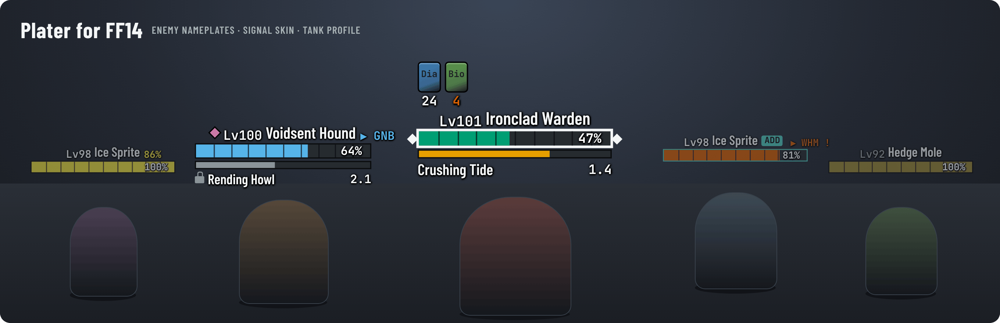
</p>

<h1 align="center">Plater for FF14</h1>

<p align="center">
  A Dalamud plugin that replaces FINAL FANTASY XIV's enemy nameplates with combat plates inspired by WoW's Plater and Threat Plates:<br>
  health, casts, your DoTs and threat, all on one plate.
</p>

<p align="center">
  
  
  
  
</p>

---

## What a plate shows

<p align="center">
  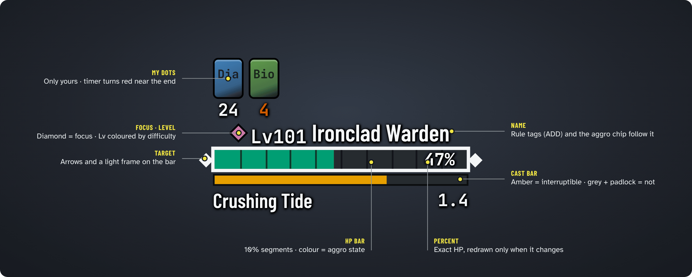
</p>

- **HP bar** with exact percent. Signal splits it into 10% segments, like HealFrames.
- **Level** before the name, coloured by how hard the enemy is compared with you.
- **Cast bar** in amber when you can interrupt it, grey with a padlock when you can't, with a countdown.
- **Your DoTs only**, with timers that turn red near the end.
- **Aggro colours**, with separate tank and DPS/healer modes (see below).
- **Target and focus**: arrows and a light frame on your target, which is drawn on top of other plates; a diamond on your focus target. Other plates are dimmed and shrunk.
- **Rules per enemy**: highlight, tag, hide, resize, never dim, or turn off aggro colours for one enemy name.
- **Profiles per role and job**, switched automatically when you change job.

## Every state at a glance

<p align="center">
  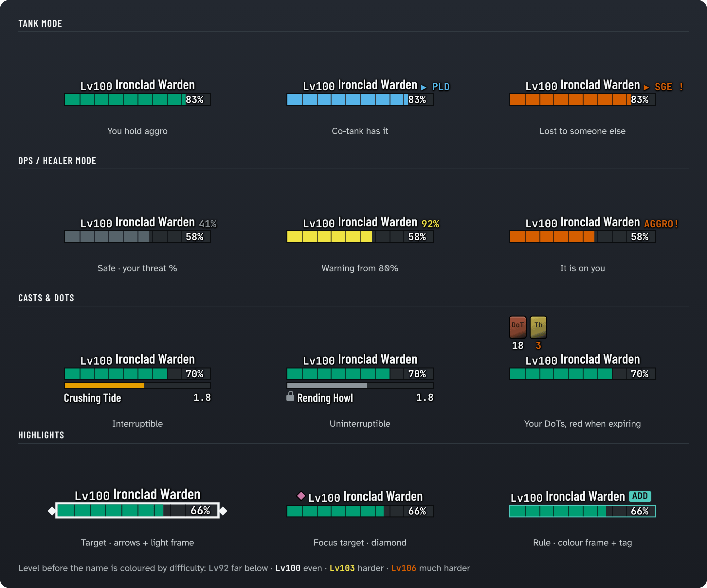
</p>

## Three skins

<p align="center">
  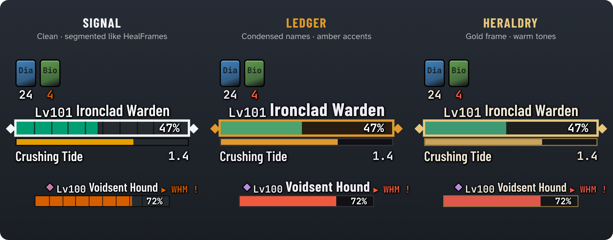
</p>

Each profile keeps its own skin and its own colour overrides for every skin. **Signal** is the default and matches the Signal style from HealFrames.

## How the HP bar colour is chosen

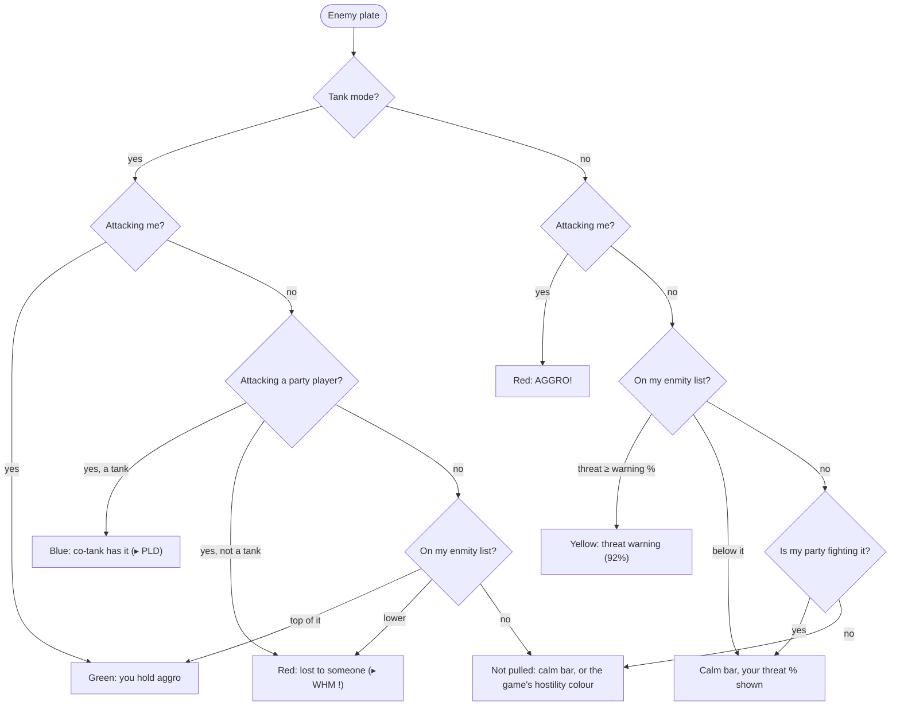

Tank or DPS/healer mode follows your job's role by default. You can also set either mode permanently. DPS and healers get the warning at 80% of the top threat by default.

## How a profile is picked

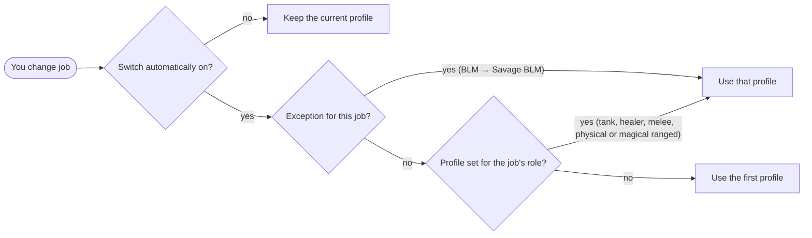

Rules are not part of any profile. They apply to every profile, and the first matching rule wins.

## Settings

Open with `/plater`. It's a native game window built with KamiToolKit, and a live preview updates as you change settings.

<table>
  <tr>
    <td width="50%">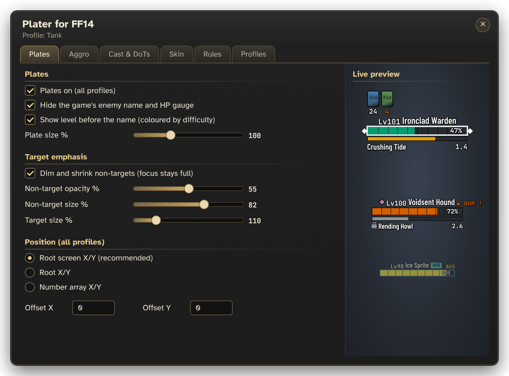<br><sub><b>Plates</b>: size, target emphasis, position</sub></td>
    <td width="50%">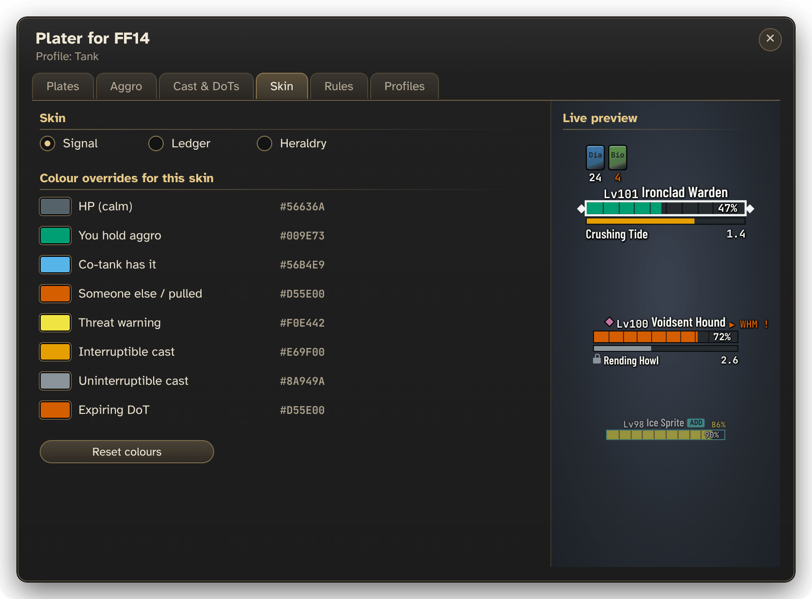<br><sub><b>Skin</b>: pick a skin and override its colours</sub></td>
  </tr>
  <tr>
    <td width="50%">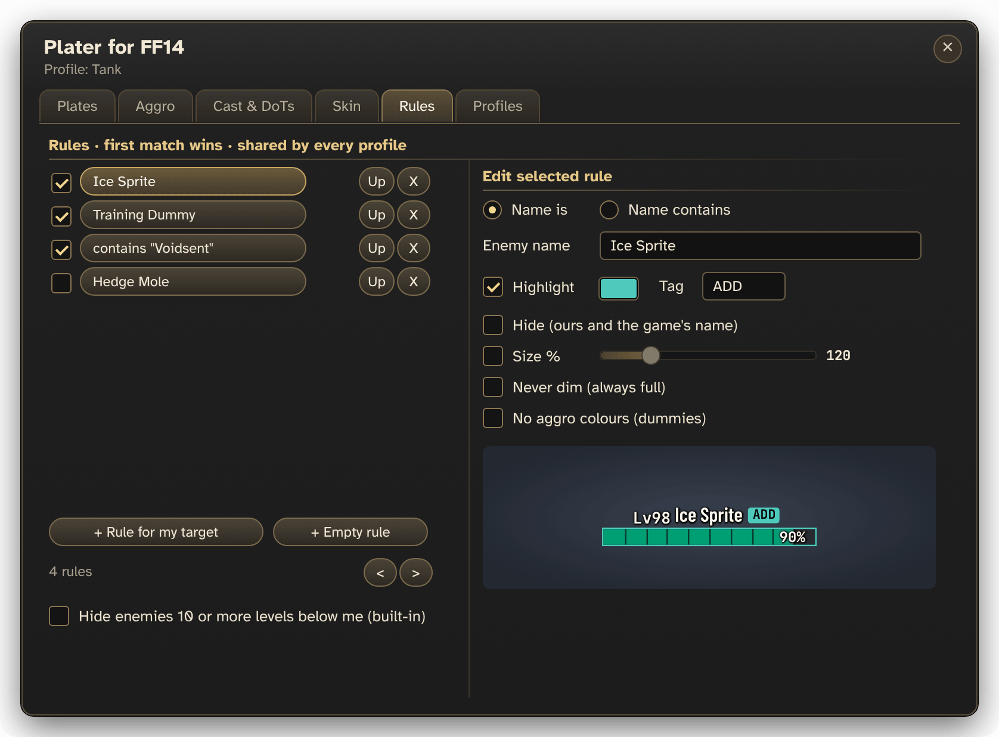<br><sub><b>Rules</b>: per-enemy highlight, tag, hide, size</sub></td>
    <td width="50%">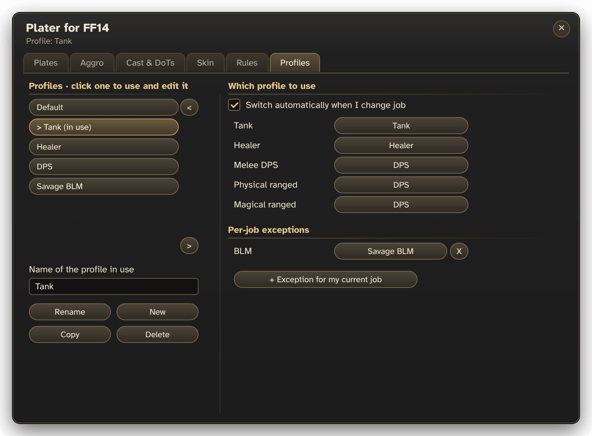<br><sub><b>Profiles</b>: per role, with job exceptions</sub></td>
  </tr>
</table>

> The images on this page are rendered from the design mockups. Fonts and icons in game come from the game itself; DoT icons are drawn as plain squares here.

## Middle-click interrupt (optional, off by default)

Under **Aggro → Click** you can turn on *Middle-click a plate: cast my interrupt on it*. One click casts one action on that enemy: **Interject** for tanks, **Head Graze** for physical ranged. Nothing is queued, repeated or automated. Clicks over other game windows are ignored.

## Install

1. In game, open `/xlsettings` → **Experimental** → **Custom Plugin Repositories**.
2. Add this URL, tick **Enabled** and save:
   ```
   https://raw.githubusercontent.com/Gompex/DalamudPlugins/main/repo.json
   ```
3. Open `/xlplugins`, search for **Plater for FF14** and install it.

## Commands

| Command | What it does |
| --- | --- |
| `/plater` | Open or close settings |
| `/plater debug` | Data probe window (enmity table, plate positions, timings) |
| `/plater on` · `/plater off` | Turn the plates on or off |
| `/plater native` | Show or hide the game's own enemy name and HP gauge |
| `/plater pos 0-2` | Position source: 0 root, 1 root screen (default), 2 number array |

## How it works

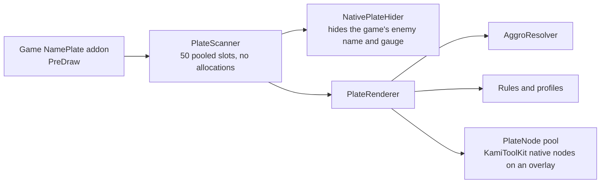

- The plates are native UI nodes, not ImGui, so they sit under the game's windows like the original nameplates.
- Each frame only writes what changed (percent, widths, colours, text), and plates are created a few per frame.
- Turned off in PvP.

## Build from source

```powershell
git clone --recurse-submodules https://github.com/Gompex/PlaterXIV.git
cd PlaterXIV; dotnet build .\PlaterXIV -c Release
```

Needs the .NET 10 SDK and XIVLauncher with Dalamud installed. KamiToolKit is a git submodule pinned to a tested commit. Releases are built by GitHub Actions when a version tag is pushed (`tools/Release.ps1 x.y.z`).

## Licence

[MIT](LICENSE). FINAL FANTASY XIV © SQUARE ENIX. This project is not affiliated with Square Enix.
